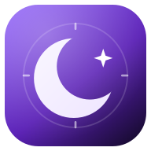

<p align="center">
  
</p>

<h1 align="center">On time — version web</h1>
<p align="center"><b>Les heures de prière en temps réel, sur ordinateur et mobile.</b><br/>
Gratuit, sans compte, sans publicité. Installable comme une application (PWA).</p>

<p align="center">
  <a href="https://krimossimo.github.io/on-time-web/">🌐 Ouvrir On time</a> ·
  <a href="../../releases/latest">⬇️ Télécharger pour Windows</a> ·
  <a href="https://paypal.me/Krimossimo">♥ Faire un don</a>
</p>

---

## Fonctionnalités

- Horaires des 6 temps (Fajr, Chourouq, Dhuhr, Asr, Maghrib, Isha), compte à rebours, dates grégorienne et hégirienne.
- **Lieu** : position de l'appareil (GPS), estimation par connexion internet, ou recherche manuelle pays + ville. Fuseau horaire automatique.
- **Méthodes de calcul** : Musulmans de France 12°, France 15°, Grande Mosquée de Paris 18°, Ligue Islamique Mondiale, Umm al-Qura, Maroc, Algérie, Tunisie, Turquie, Golfe… ou angles personnalisés.
- **Madhab** pour l'Asr (Standard ou Hanafi) et **ajustements** de −15 à +15 min par prière.
- **Alertes** prière par prière, rappel avant la prière, six sons doux au choix.
- Thème sombre ou clair, couleur d'accent, format 12 h / 24 h, plein écran.
- Fonctionne hors-ligne une fois chargée ; réglages enregistrés sur l'appareil.

### Différences avec la version Windows

| | Web | Windows |
|---|---|---|
| Notifications | tant que la page (ou l'app installée) est ouverte | toujours, en arrière-plan |
| Plein écran | ✓ (sauf iPhone, non pris en charge par Safari) | ✓ |
| Toujours au premier plan, lancement au démarrage, zone de notification | — | ✓ |
| Désinstallation | « Réinitialiser » efface les réglages | ✓ |

## Développement

Aucune dépendance : Node.js 18 ou plus suffit.

```bash
npm test         # construit dist/ et vérifie les calculs et les fichiers
npm run serve    # http://localhost:8080/
npm run sync     # recopie les fichiers partagés depuis le projet Windows (dossier parent)
```

```
src/core/            moteur de calcul — identique à la version Windows (src/main/prayer.js, store.js, vendor/)
src/js/web-api.js    remplace le processus Electron : réglages, lieu, alertes, plein écran, PWA
src/js/app.js        interface (adaptée de src/renderer/app.js de la version Windows)
src/css/styles.css   styles — identiques à la version Windows
src/css/web.css      mise en page web, mobile, écran de bienvenue
scripts/build.mjs    regroupe le moteur pour le navigateur et génère dist/
site.config.json     version et lien de l'installateur Windows
```

La publication est automatique : chaque envoi sur `main` construit le site et le déploie sur GitHub Pages (`.github/workflows/pages.yml`).

## Crédits

- Calculs astronomiques : [adhan-js](https://github.com/batoulapps/adhan-js) (MIT)
- Fuseaux horaires : [tz-lookup](https://github.com/photostructure/tz-lookup) (CC0)
- Recherche de villes : © contributeurs [OpenStreetMap](https://www.openstreetmap.org/copyright) (Nominatim)

---

Application créée par **Krimossimo** — © 2026 Krimossimo. Tous droits réservés. Voir [LICENSE](LICENSE).
